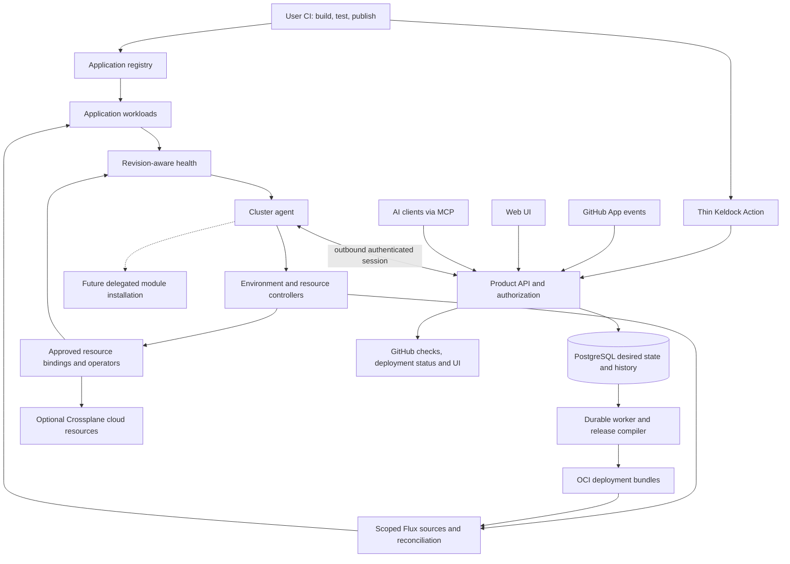

# Keldock architecture

Updated 2026-10-29. Accepted design with an experimental core and an unpublished M6
[self-hosted candidate](runtime/alpha/README.md). Current code and
local evidence are recorded in the [runtime guide](runtime/local-development.md) and
[fresh-target assisted acceptance](validation/m6-fresh-target.md);
unimplemented product and expansion gates remain explicit in the implementation plan.

## Product contract

Keldock is a FOSS application and infrastructure control plane for people and AI agents,
starting on customer-controlled infrastructure. Individuals and small teams can use the
complete self-hosted product without an enterprise identity provider or paid account.
An optional hosted service later runs the same core against customer-owned clusters.
See [product direction](product/direction.md).

An application contains HTTP services, workers, schedules, release jobs, and resource
bindings. A release fixes the exact version of every component. A deployment applies
that release with immutable environment configuration and resource revisions.

Users bring CI for builds, tests, and image publication. GitHub Actions is supported
first. A thin Keldock Action consumes a complete component-to-image-digest map and
provenance, authenticates through OIDC, and requests deployment. It can wait for
readiness or return a durable receipt immediately.

The application repository needs source/build inputs, `keldock.yaml`, and submission in
its existing pipeline or an optional starter. It needs no Flux manifests, Kubernetes
deployment YAML, Helm/Terraform, separate deployment repository, generated-manifest
commits, or cluster credentials. Keldock compiles deployment configuration into immutable
OCI bundles and manages Flux internally. It does not run user builds.

## Focused first release

- One organization, multiple projects, one existing customer-controlled cluster.
- GitHub.com, user-owned Actions pipelines, immutable prebuilt images, and multi-service
  monorepos.
- Flux workload delivery, supported ingress/certificates, isolated PR previews, staging,
  and explicit production promotion policy.
- PostgreSQL via CloudNativePG as the first optional application capability, with a
  customer-supplied backup destination and demonstrated isolated restore.
- A small authenticated MCP surface for discovery, diagnostics, admitted-release
  deployment to nonproduction, and scoped retry/cancel; versioned skills for those flows.

Automated AWS provisioning is optional and does not gate alpha. General remote module
installation, Vault/Temporal management, additional clusters/repositories/providers,
standalone-controller packaging, hosted tenancy, and provider-operated compute follow
separate milestones. Core installation requires neither Crossplane, AWS, Vault,
Temporal, a service mesh, nor an LLM provider.

## Repository and installation boundary

| Owner                  | Responsibility                                                                                                |
| ---------------------- | ------------------------------------------------------------------------------------------------------------- |
| Keldock repository     | Reusable API, UI, agents, controllers, Action, MCP, skills, schemas, capability definitions and packages      |
| Operator installation  | Account/cluster bootstrap, versions, policy, grants, supplied dependencies, credentials and recovery material |
| Application repository | Source/build inputs, versioned application definition and user-owned CI                                       |

Create runtime directories only with their first executable implementation. Keep real
application instances, accounts, domains, credentials, and infrastructure state out of
the product repository. Existing private-platform resources retain their current owners
until a separately reviewed transfer.

## Runtime topology

These are logical boundaries, not one service per box. The implemented baseline is Go
for a modular API/worker and outbound agent/registrar, with PostgreSQL for durable state.
The [first runtime profile](decisions/0004-first-runtime-profile.md) selects development
packaging. [Shared authentication](decisions/0005-shared-authentication-and-remote-mcp.md)
now protects a Next.js/React console, enrolled agents and a remote MCP adapter with
explicitly consented nonproduction operations. [Preview and diagnosis skills](runtime/agent-workflows.md)
use the same bounded service as the console, with immutable admitted releases and
revision-bound receipts; [ADR 0006](decisions/0006-bounded-nonproduction-operations.md)
records the preview policy and mutation boundary.
The console prioritizes deployment health and exposes account, cluster, GitHub and MCP
lifecycle management. The [GitHub delivery profile](runtime/github-delivery.md) adds
installation-owned App setup, a thin OIDC Action, durable feedback and scoped private
GHCR pull credentials. CI publication, bundle publication and cluster readers retain
separate authority. Pin dependencies with implementation evidence.

Validate a PostgreSQL outbox/leased-worker default. Temporal may be an optional future
engine profile; it is not required for the minimum installation. Internal workflow
execution must remain independent of any customer Temporal installation Keldock manages.

## Authority and reconciliation

| State/resource                                               | Sole authority or writer                                       |
| ------------------------------------------------------------ | -------------------------------------------------------------- |
| Application definition and build inputs                      | Versioned application source                                   |
| Builds, tests and application image publication              | User CI                                                        |
| Approved deployment/resource/capability intent and history   | Control-plane PostgreSQL                                       |
| Managed cluster projections                                  | Agent reflecting approved desired revisions                    |
| Namespace, guardrails, identities and generated Flux objects | Trusted environment registrar                                  |
| Application workloads                                        | Flux using application-scoped identities                       |
| Approved AWS resources                                       | Optional Crossplane managed resources through scoped providers |
| Database/certificate internals                               | CloudNativePG/cert-manager respectively                        |
| Controller installation/shared substrate                     | Operator tooling; later delegated capability manager           |

Agents report observations and execute approved intent; they do not decide promotion or
overwrite desired state. Cluster projections are not another editable source of truth.
In standalone mode, operator-owned CRDs would be authoritative with no managed-mode
agent competing for their specification. Packaging that mode is deferred.

Resource retention is independent of preview/application deletion. Changing an owner,
adopting a service, or deleting persistent data is a separate authorized operation.
See the [authority decision](decisions/0002-state-and-reconciliation.md).

## Domain model

| Concept                    | Purpose                                                                     |
| -------------------------- | --------------------------------------------------------------------------- |
| Organization / Project     | Installation ownership, authorization, repository scope and limits          |
| ApplicationDefinition      | Runtime service graph, jobs, routes and required capabilities               |
| ApplicationRelease         | Immutable definition/source snapshot, complete image digests and provenance |
| Environment / Deployment   | Placement, policy, desired generation and selected immutable deployment     |
| CapabilityDefinition       | Versioned integration contract, dependencies, permissions and compatibility |
| CapabilityInstallation     | Supplied, managed or external instance with version, owner and health       |
| Resource / ResourceBinding | Independently retained project resource and authorized consumer access      |
| CloudConnection            | Optional account/region/capability scope and provisioning identity          |
| Operation / Observation    | Durable work/attempt history and evidence for an exact desired revision     |

Core application/release/operation/observation contracts have executable validation.
Accounts, project grants, single-use enrollment, agent leases/revocation and MCP grants
are durable. The [optional AWS profile](runtime/cloud/README.md) implements typed
resource allocation and binding APIs. Generic capability installation and PostgreSQL
allocation retain their separate evidence gates.
Persistence establishes operator-owned organization/project placement and rejects reassignment.
One-organization v1 does not justify trusting caller-supplied tenant IDs.

## Interfaces, modules and portability

[Delivery](architecture/delivery.md) fixes CI, releases, previews, health, and rollback.
[Capabilities](architecture/capabilities.md) separate installation from resources and
bindings, and define the first PostgreSQL integration.

[MCP and skills](architecture/agent-interfaces.md) use the same authenticated APIs,
operation receipts, policy, and retention rules as the UI. No separate privileged agent
path exists. Supported API operations grow before their tools and skills are advertised.

The [authentication contract](runtime/authentication.md) separates human sessions, CI
OIDC/provenance, enrolled agent credentials and delegated MCP grants. The Go API checks
current authority at each boundary; the Next.js server forwards the session through an
uncached server-only data layer. MCP uses an explicitly consented project subset and
can select admitted nonproduction releases and retry/cancel through explicit operation
consent. Cloud administration and adoption remain outside those grants.

The [hosted boundary](architecture/hosted-control-plane.md) preserves customer ownership,
outbound agent sessions, outage behavior, and portable recovery. Hosted topology alone
does not prove service isolation, availability, billing, or support readiness.

See [onboarding](architecture/onboarding.md),
[security and operations](architecture/security-and-operations.md),
[implementation plan](implementation-plan.md), and [primary references](references.md).

## M6 data and recovery boundary

The packaged public API/worker and console have no Kubernetes credentials. Enrolled
workload registration and PostgreSQL provisioning use separate processes, ServiceAccounts,
credentials and RPC routes. Application declarations can request an approved PostgreSQL
profile and select consumers; they cannot select namespace, source UID, Secret or backup
identity. Allocation state and data survive preview cleanup.

Control-plane snapshots capture database state, referenced private files, bundle graphs
and admitted workload image graphs. Restoration targets an empty independent database
and stays fenced until surviving workload generations, deletion tombstones and retained
database identities agree. Recovered browser/MCP/agent credentials are revoked. A native
PostgreSQL restore creates a separate unbound cluster with a read-only archive identity;
it never replaces the source or automatically cuts application traffic over.
